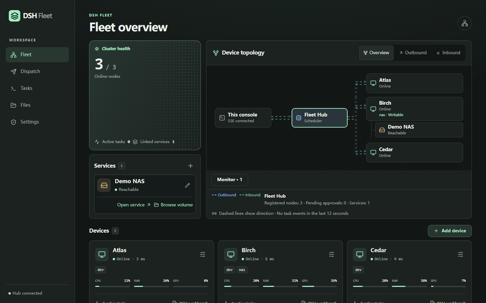
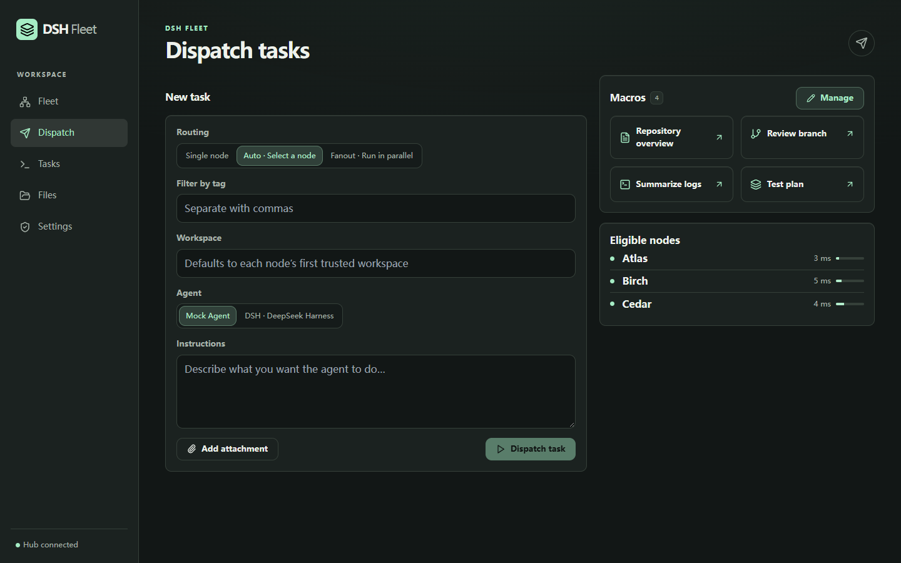
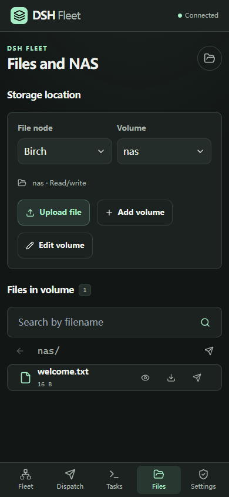
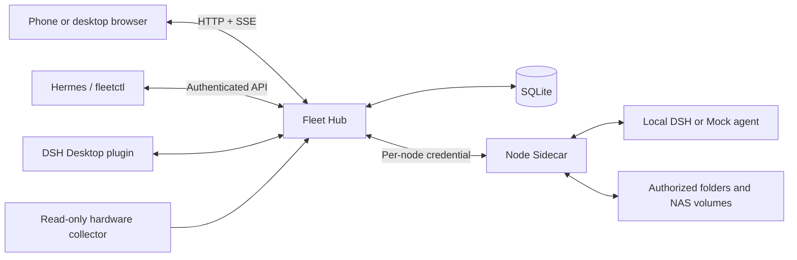

# dsh-fleet

[简体中文](README.zh-CN.md) · [Desktop plugin](integrations/dsh-app-plugin/README.md) · [Contributing](CONTRIBUTING.md)

Run an AI task on a computer you own, approve its next action from your phone, then open the result in the same workspace on that computer. A Fleet Hub hosts the bilingual web console. Each enrolled machine runs a Sidecar alongside its local agent and exposes only the file volumes you configure.



## Try it on one computer

Install **Python 3.11 or later, uv, and Node.js 22.12 or later with npm**. Extract or clone the source and open a terminal in the directory containing `pyproject.toml`.

```sh
uv run --locked --no-dev python deploy/demo.py --port 0
```

The first launch downloads dependencies and builds the PWA. The terminal prints a loopback URL and a generated password. Open that URL on the same computer, choose **English** or **简体中文**, and sign in. You should see **Atlas**, **Birch** and **Cedar** online. These are three local Sidecar processes using the Mock agent. The demo needs no model key, NAS or VPN.

### Dispatch, approve and read a result

1. Open **Dispatch**. Select **Single node**, **Birch** and **Mock Agent**. Leave **Workspace** empty to use the node’s first trusted workspace.
2. Paste `[approval] [artifact] Prepare a short workspace report` into **Instructions** and select **Dispatch task**. These two markers belong to the Mock agent and make this example repeatable.
3. Open the pending approval banner. Review the node, directory and requested operation, then choose **Allow once** and confirm before the request expires. If it expires, dispatch the example again.
4. Open **Tasks**, choose the run and expand **Task artifacts**. Preview the Markdown or CSV, download a file, or choose **Save to NAS**. Pick **Birch → nas** and use a new filename.
5. Open **Files**, select **Birch** and the **nas** volume, and find the saved file. The mobile picker lets you switch node and volume independently.





Press **Ctrl+C** in the launching terminal to stop the four processes. Demo configuration, credentials and logs live under the ignored `.run/demo/` directory. A new demo gets a fresh database. For an existing Hub, its SQLite database persists tasks and settings across restarts.

## How the pieces connect



| What you want to do | Where to go |
| --- | --- |
| Pick a host, find an idle machine or compare responses | **Dispatch** supports single-node, tag-filtered Auto and parallel Fanout. Macros accept parameters such as `{{repo}}`. |
| Follow a long run | **Tasks** offers chat and terminal views, status filters, project groups, soft deletion and artifact previews. |
| Continue on the target desktop | Enable **Continue in DSH Desktop** for a compatible DSH task. After a successful handoff, the task detail identifies the workspace and conversation. Share an existing desktop session with `/fleet on` in that session. |
| Send a file from your phone | **Files** browses named volumes. Upload to a writable inbox or mapped share. Read-only volumes support browsing and downloads. |
| Watch a compute server without dispatching to it | Configure the SSH hardware collector. CPU, memory, disk and GPU samples appear separately from execution nodes. Disk alerts and GPU idle watches can feed a private notification channel. |
| Change language or appearance | Open **Settings → Security and approvals → Account and session → Language**. Fleet stores the signed-in preference on the Hub. **Appearance** and **Layout and shortcuts** control themes, density and device cards. Task text and filenames keep their original language. |

## Deploy a private fleet

**1. Start one persistent Hub.** Copy `deploy/hub.example.yaml` to `local/hub.local.yaml`. Choose a local bind address and the client CIDRs for your network. Provide a unique `FLEET_PASSWORD` and `FLEET_API_KEY` in the service environment or the private configuration. Use persistent storage for the database. For Linux with systemd:

```sh
bash deploy/install-linux-hub.sh local/hub.local.yaml
systemctl --user status dsh-fleet-hub
```

For foreground use, build the frontend with `npm --prefix apps/web-pwa ci` and `npm --prefix apps/web-pwa run build`, then run `uv run fleet-hub --config local/hub.local.yaml`. Hub serves both the site and API. For an installable PWA on a phone, use a trusted HTTPS endpoint reachable over your private network. The loopback demo address belongs to the computer running it.

**2. Enroll a node.** Get the source on the new machine. In **Fleet → Add device**, generate a one-time enrollment command and run it in the repository root on the target. Supply a node address reachable from the Hub. Pairing creates a private node configuration and independent credential. The Hub and node must each be able to reach the other on their configured ports.

On Windows, run the following as the interactive account that uses DSH and the mapped drives. The installer registers an at-logon task. Firewall changes may require elevation.

```powershell
.\deploy\install-windows-sidecar.ps1 -Config .\local\node.local.yaml
```

On Linux or macOS, launch `uv run fleet-sidecar --config local/node.local.yaml`. Confirm the node reports online. Add only the workspaces and volumes you intend to share. Start with a read-only NAS volume if browsing is sufficient.

**3. Connect the real agent.** Install DSH on the target and verify a local conversation first. To use the desktop model bridge and handoff, run the command below as that same user, restart DSH Desktop, and inspect the selected node’s **Desktop plugin** heartbeat in Settings. Desktop and CLI capabilities vary by version. [Plugin setup and permissions](integrations/dsh-app-plugin/README.md)

```sh
uv run python integrations/dsh-app-plugin/manage.py install --node-config local/node.local.yaml
```

**4. Choose execution policy.** `balanced` applies workspace and operation checks. `strict_hash` restricts scripts to administrator-registered hashes. `autonomous` requires explicit confirmation and still operates within the node’s executor permissions. Review the node’s supported runtimes before granting access to sensitive workspaces. [Agent and execution details](docs/adapters.md)

### Network and optional integrations

- Binding supports a fixed IP, a named interface or CIDR matching. WireGuard, EasyTier, Tailscale, ZeroTier and LAN deployments use the same Fleet APIs. Keep allowlists narrow and protect administrator and node credentials. [Operations](docs/operations.md)
- Hermes and `fleetctl` can query nodes, dispatch tasks and read results. Configure explicit notification recipients and enforce sender authorization at your chat gateway. [Hermes skill](integrations/hermes/SKILL.md)
- DSH Pocket is a separately installed optional service. Fleet can use a direct bookmark or an isolated-origin live view; Pocket handles its own password. [Pocket setup and limitations](docs/pocket.md)

## Troubleshooting

| Symptom | First check |
| --- | --- |
| The demo URL opens on the host but not on a phone | The demo binds to loopback. Use a persistent Hub bound to its private-network interface for phones. |
| A paired node stays offline | Verify the Sidecar is running, its advertised address matches its listener, and the Hub source is allowed by its CIDR list and firewall. |
| A mapped volume appears empty or unavailable | Check readability in the same Windows user session that runs the Sidecar. Confirm the mapping and volume root there. |
| A task completes but no desktop conversation appears | In the task details check the handoff result, then check the plugin heartbeat, selected model and workspace on that node. |
| The UI still looks like an older build | Rebuild the PWA, ensure the Hub serves the new `dist` directory, then reload the page. |

## Development and license

The monorepo contains `apps/fleet-hub`, `apps/node-sidecar`, `apps/web-pwa`, shared `packages/protocol`, optional `integrations`, deployment tools and tests. Run `uv run --locked pytest -q` for backend tests. Build, browser and contribution instructions are in [CONTRIBUTING.md](CONTRIBUTING.md). Fleet is distributed under the [MIT License](LICENSE). External applications and dependencies retain their own licenses.

## Credits and companion plugin

DSH Pocket supplies the mobile live view. It is maintained by **shaobeichen and the dsh-pocket contributors** and distributed under GPL-2.0. Install Pocket separately on the target computer. Fleet communicates with its local HTTP/WebSocket service. [Upstream project and installation](https://github.com/shaobeichen/dsh-pocket) · [Pocket license](https://github.com/shaobeichen/dsh-pocket/blob/main/LICENSE)

The optional [dsh-lan-sync](https://github.com/yzq0314/dsh-lan-sync) companion synchronizes selected Desktop plugins and supported preferences between your own machines. Both Fleet and the sync plugin have their own MIT licenses.
