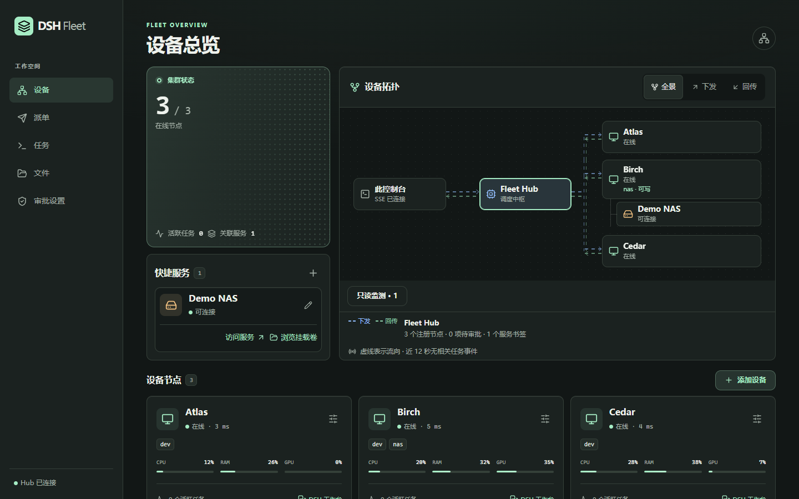
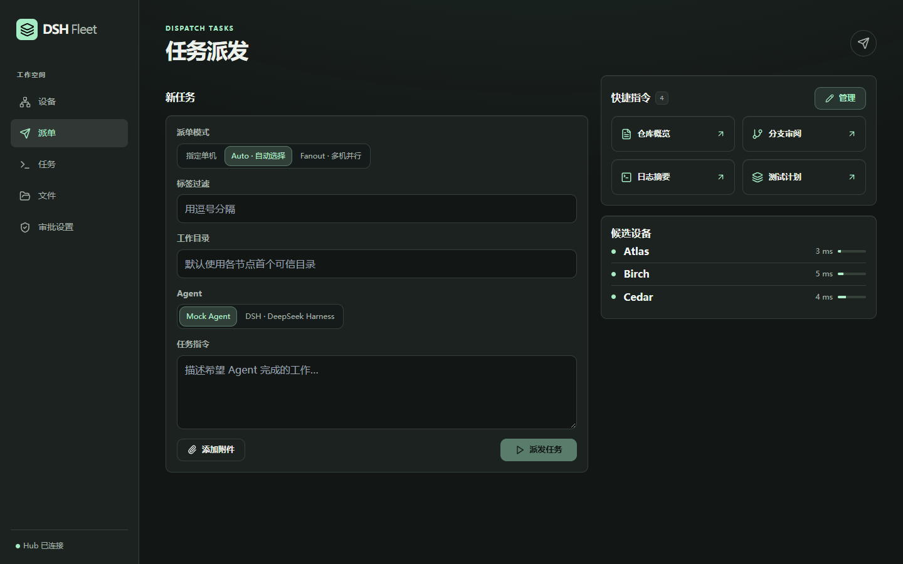
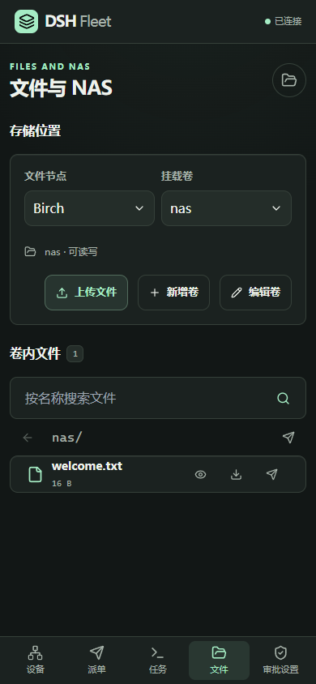
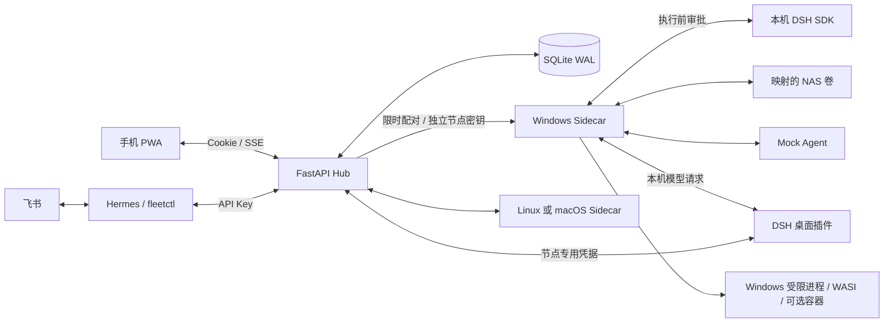

# dsh-fleet

[English](README.md) · [架构与功能](docs/project-overview.zh-CN.md) · [贡献指南](CONTRIBUTING.md)

用手机或聊天机器人，把任务派给自己管理的电脑。Hub 汇总设备负载、任务、文件和审批。每台电脑的 Sidecar 在本机用户会话中运行 Agent，也可以把指定的 NAS 映射目录作为命名卷提供给手机。

Pocket 同屏沿用现有 Hub 和 Sidecar 端口，服务器告警可送达现有的本人飞书私聊。部署与使用见 [同屏、监控与节点升级](docs/pocket.md)。



## 在本机跑通第一个任务

在仓库根目录运行下面的命令。需要 Python 3.11+、uv 和带 npm 的 Node.js 22.12+。首次运行需下载依赖、构建 PWA。已有依赖和前端产物时，一条命令即可启动本机四个进程。

```sh
uv run --no-dev python deploy/demo.py
```

1. 打开终端给出的回环地址，输入本次生成的密码。设备页会出现三台演示设备和 NAS 服务卡片。
2. 在「派单」选择 Mock、自动路由，点选快捷指令并填参数。在提示词中加入 `[approval]` 可演练一次审批。
3. 在「审批与设置」核对内容并允许一次，回到「任务」查看结果。在「文件」选 Birch 的 nas 卷，上传一份 CSV、预览并交给 Agent。
4. 在启动终端按 Ctrl+C 关闭集群。端口冲突时加 `--port 0`。本机演示的密码、API Key、数据和日志在忽略目录 `.run/demo/`，每次启动使用新的凭据和演示数据库。

### 跟做一次「派单 → 审批 → 转存 NAS」

在派单页选「指定单机 → Birch → Mock Agent」，工作目录留空，在任务指令中输入：

```text
[approval] [artifact] 生成一份简短的工作区报告
```

1. 点「派发任务」。看到审批横幅后，查看请求的节点、工作目录和命令，选择「允许一次」并确认。演示审批有时限，超时后可重新派单。
2. 进入「任务」，打开这条记录，展开「任务产物」。点击 Markdown、CSV 或图片即可预览。
3. 在一个产物上点「转存 NAS」，选 Birch 的可写 `nas` 卷并填写新的文件名。切到「文件 → Birch → nas」核对。手机上点击节点或卷选择框即可切换。
4. 登录页可直接选 **English / 简体中文**。已登录时进入「审批设置 → 安全与审批 → 账号与会话 → 语言」。选择保存在 Hub，另一台设备刷新后也会生效。文件名、任务指令、模型回答和原始日志保留原文。





演示地址只供运行它的电脑访问。要从手机连接真实设备，请先按下文部署持久化 Hub 和节点，再用手机可达的内网地址登录。

## 架构



Hub 先在 SQLite 事务中写入派单，随后将稳定的任务 ID 发给节点。节点去重，Hub 按序号抓取增量事件。浏览器通过同源 SSE 订阅；断线后用 Last-Event-ID 续读。单机路由指定设备，Auto 按标签筛选在线节点，再按活跃任务数和 CPU 负载排序。Fanout 将各节点的独立任务归入同一组，结果按节点查看。后台探活和任务轮询独立运行。

审批记录由执行操作的 Sidecar 持有。Hub 和两个客户端共享同一条审批记录。允许一次对应一次工具调用，信任目录的有效期为当前任务，高危规则在信任目录内仍然生效。无人处理时由节点超时拒绝。配置 `file_hook` 或 `webhook` 可把审批变化送给 Hermes 的通知接收器；接收端按事件 ID 去重。

## 部署 Hub

1. 复制 `deploy/hub.example.yaml` 到 `local/hub.local.yaml`。设置绑定方式、允许网段和 SQLite 文件位置。给运行账户配置独立的管理员口令与 CLI Key，字段为 `password` 和 `api_key`，对应环境变量为 `FLEET_PASSWORD` 和 `FLEET_API_KEY`。生成密钥可用 `python -c "import secrets; print(secrets.token_urlsafe(40))"`。systemd 读取其用户服务环境或私有 YAML。
2. 运行 Linux 安装脚本。它安装项目、构建控制台并创建当前用户的 systemd 单元。需要无人登录时自启的机器可为该服务用户配置 linger。
3. 在手机使用可信 HTTPS 地址访问 Hub，再选择安装到主屏幕。Hub 支持 `tls_cert`、`tls_key`、`secure_cookie: true` 及 `public_url`。浏览器的 Service Worker 需要安全上下文，本机回环可用于开发。离线时可打开界面外壳，节点操作仍需联网。[Service Workers 规范](https://www.w3.org/TR/service-workers/)

```sh
bash deploy/install-linux-hub.sh local/hub.local.yaml
systemctl --user status dsh-fleet-hub
uv run python deploy/doctor.py --config local/hub.local.yaml
```

手工前台运行可用 `uv run fleet-hub --config local/hub.local.yaml`。若单独构建前端，在 `apps/web-pwa` 运行 `npm ci`、`npm run build`，再启动 Hub。Hub 托管 dist，API、SSE 和页面共用端口。

## 接入 Windows、Linux 与 macOS 节点

在新机器 checkout 本仓库，在手机设备页生成一次性配对命令，在新机器仓库根目录执行。输入 Hub 可访问的 Sidecar 地址。脚本把独立密钥写入 `local/node.local.yaml`。默认在当前用户的 Documents 中创建新的 Fleet-Work 工作区和可写投递箱。已有同名目录时会新建专用目录。可以用 `--bind-ip` 指定 DNS 节点名对应的本机监听地址，`--workspace`、`--cidr` 可重复。接入 IP 和域名都可在设备页热改。

Windows 在实际使用 DSH、映射盘的用户账户下运行：

```powershell
.\deploy\install-windows-sidecar.ps1 -Config .\local\node.local.yaml
```

从 0.2.1 起，Windows 安装器优先复用本机的 uv。未安装 uv 且 GitHub 发布接口返回限流时，安装器会依次尝试当前用户的 WinGet 和 Python/pip。节点配置通过 .NET 单独设置 DACL，访问权限限于当前用户和 SYSTEM。PowerShell 5.1 启动器保留 Uvicorn 的标准错误日志，并使用 Python 退出码报告服务结果。

脚本以普通用户的交互令牌注册 AtLogOn 隐藏计划任务。配置 Windows 防火墙时，需要以该用户提升权限运行安装器；已有合适入站规则时可使用 `-SkipFirewall`。节点登录后，先验证映射卷在该用户会话中可读。Linux/macOS 可以前台启动同一个 Sidecar：

```sh
uv run fleet-sidecar --config local/node.local.yaml
```

在节点的私有配置中设置 `trusted_workspaces`，按需开启 `allow_arbitrary_dirs`。在 `volumes` 登记名称、路径和 `read_only`。把 NAS 卷关联至 Hub 服务书签，就可以在直达 DSM 和经 Sidecar 浏览文件之间切换。预配节点可用 Hub YAML 的 `nodes` 初始化，同时在 Sidecar 填 `node_id`、`hub_url`，使删除或停用节点后直连请求也经吊销校验。首次导入完成后，Hub 以数据库为准。

### 复用桌面的模型和登录

在已配对的节点上，以运行 DSH App 的同一用户执行以下命令。重启桌面应用后，在手机「审批与设置」中选择该节点查看插件心跳。插件支持在桌面会话里派单、访问被授权的 NAS 卷，并把选定会话的进展与原生审批同步到手机。[插件安装、授权和卸载](integrations/dsh-app-plugin/README.md)

```sh
uv run python integrations/dsh-app-plugin/manage.py install --node-config local/node.local.yaml
```

Sidecar 优先采用私有 YAML 中显式配置的 `dsh_provider`。自动模式先使用运行中的桌面模型桥，随后使用受支持的 DSH 本地 profile 与凭据配置，最后才从进程环境选择模型。桌面账号登录用户可通过插件复用当前默认模型。模型请求在本机转交给 DSH，Hub 与手机只接收任务事件。仅使用 CLI 的设备也可指定官方 DeepSeek 或 OpenAI-compatible 模型服务。[模型配置示例](integrations/dsh-app-plugin/README.md)

### 仅监控 Linux 服务器

Hub 私有配置中的 `hardware_monitor_dir` 指向采集快照目录。设备页从该目录读取 CPU、内存、根分区可用空间和 NVIDIA GPU 利用率及显存。快照超过 60 秒会标记为过期。监控对象独立于执行节点，只在管理员控制台显示硬件数据。

在能通过 SSH 访问目标的采集机上使用 `deploy/collect_ssh_hardware.py` 和同目录的 `read_linux_hardware.py`。前者接收一个私有 JSON 配置文件路径，包含 `target`（已校验主机密钥的 SSH 目的地）、`name`（显示名）及 `output`（上述目录内专属 JSON 文件的绝对路径）。建议用 systemd 用户定时器每 15 秒调用一次。目标机需要 Python 3；安装了 `nvidia-smi` 时还会采集显卡。采集器通过标准输入运行固定的只读探针，Hub API 不接受 SSH 命令。

### 手机上派单，回到电脑续聊

选择目标节点和工作目录，派单时选择 DSH 并勾选「在 DSH App 中续聊」。使用桌面模型桥的任务成功后，打开手机任务详情查看交接结果。显示「已加入 DSH App 对话列表」时，在目标电脑的 DSH App 中打开同名的 `Fleet · …` 会话即可继续。桌面会话保留原工作区、可见消息、工具调用和对应结果。新一轮使用桌面当前的权限与审批设置。此前在旧版节点上完成的任务仍可在 Fleet 的任务页查看。

新版桌面插件在线时，也可以留在手机的「任务 → 对话」中，使用「继续此 DSH 会话」发送下一轮。两端沿用同一个原生会话 ID。点「终端」可按时间查看工具、日志和审批事件，并切换是否跟随输出。任务队列支持按设备筛选、搜索、按项目分组，以及将已结束的任务移到「最近删除」再恢复。

打开「设备」可查看拓扑，新设备完成注册后会自动出现在图中。在线链路上的蓝色虚线沿下发方向移动，绿色虚线沿回传方向移动。节点确认接单，或发回工具结果、日志和审批时，对应方向会短暂加速并高亮。离线和停用节点显示静态连线，系统开启「减少动态效果」时保留颜色和箭头。点某台设备的「DSH 工作台」，可以查看该机任务、查看主动共享的桌面会话，或直接向该机派单。已运行官方 DSH Web 的主机还可配置独立网页登录入口。[按主机使用 DSH Web](docs/operations.md)

### 选择节点安全档位

| 档位 | 常用场景 | 执行规则 |
| --- | --- | --- |
| `balanced`（默认） | 日常开发、临时脚本、项目测试 | 信任目录内的普通读写、动态 Python 与 pytest 可直接运行。高危内容、越界访问和较大的输入集触发审批。 |
| `strict_hash` | 生产检查脚本 | 仅运行管理员在 `checks` 中登记名称、位置和 SHA-256 的脚本，每次运行前复核。此类脚本以节点用户权限执行。 |
| `autonomous` | 已隔离的常规批处理 | 在设置页二次确认后开启。受限来宾自动处理常规脚本与批量输入，保留宿主路径、危险操作规则、日志和中止按钮。 |

在私有节点 YAML 中设置 `policy_mode`，也可以从手机按节点热切换。更改档位或规则会中止该节点正在运行的任务。Windows 的 `balanced` 默认使用已安装的 CPython、Windows PowerShell 和 Node.js，读取脚本及显式声明的输入快照。进程以受限身份运行，节点收集输出并负责取消。需要 WASI Python 或 pytest 时安装 `uv sync --no-dev --extra sandbox`。也可按语言配置固定 ID 的本地 Linux 镜像。[运行范围与插件开发](docs/adapters.md)

### 在手机查看工作成果

演示派单中加入 `[artifact]` 可生成 Markdown 报告、CSV 与图片。打开任务详情即可阅读报告、浏览表格、放大图像、下载原文件，或选择已授权的可写卷转存。转存由 Hub 流式中转，目标重名时保留原文件。真实 DSH 的工作区产物由已观察到的文件操作建立关联，卷外可预览文件按任务留存快照。

## 切换加密网络

| 模式 | 私有配置 | 行为 |
| --- | --- | --- |
| 固定地址 | `bind_mode: ip`、`bind_ip` | 只绑定指定本机 IP |
| 按网卡 | `bind_mode: interface`、`interface` | 使用匹配名称的网卡地址 |
| 按网段 | `bind_mode: cidr_match`、`cidr` | 使用属于该 CIDR 的本机地址 |

WireGuard、EasyTier、Tailscale、ZeroTier 和普通局域网使用相同接口。迁移时调整 Hub 节点记录中的 URL 和相关书签；本机监听 IP 或允许网段有变化时，更新相应进程配置并重启该进程。Hub 路由地址编辑即时生效。来源限制使用 TCP 对端地址。反向代理部署时，代理须自己限制客户端网段，Hub 应只接受代理端地址。多网卡有重叠网段时可用固定 IP 消除歧义。

WOL 需要目标设备启用硬件唤醒。在设备设置填写 MAC、广播地址；通过节点字段 `wake_proxy` 可指定同 LAN 的已配对节点代发。发送成功表示已发出魔术包，上线结果看随后探活。

## Hermes、插件和运维

- Hermes 使用标准库 CLI 和 Hub 专用 API Key。把技能安装到现场 Hermes 配置的技能目录。可选 `feishu_cards.py` 消费审批事件，在指定飞书会话创建卡片，再更新同一条消息，支持断点续读。聊天操作者身份由现场网关校验。[Hermes Skill](integrations/hermes/SKILL.md)
- 新增 Agent 时实现事件解析、执行前审批和进程清理，再在启动时注册适配器。[适配器协议与测试](docs/adapters.md)
- 配对、持久化、服务恢复、审批钩子和数据库备份见[运维说明](docs/operations.md)。
- OpenSSH 分发工具读取本地 bootstrap 清单，支持按别名选择单台或多台设备并预演。用 PowerShell 的 `-DryRun` 查看计划；发布包取自本地 Git 快照。
- 运行 `uv run pytest -q` 检查协议、安全、真实回环集群和 CLI。浏览器验收从仓库根目录运行 `uv run python tests/ui/run.py`，它会构建 PWA、启动独立集群，再运行 Playwright。浏览器可使用 Playwright Chromium 或本机 Chrome。截图保存在 `tests/screenshots/`。[本地验收记录](docs/acceptance.md)

## 开源范围

源码、通用示例与模拟数据可分享。`local/`、`docs/discovery.local.md`、环境文件、演示运行目录和 SQLite 文件由 Git 忽略。发布前在仓库根目录运行 `uv run python deploy/privacy_check.py`。项目采用 MIT 许可证，DSH 与第三方依赖保留各自许可。[许可证](LICENSE)

## 手机与桌面的外观和布局

打开 **审批设置 → 外观与皮肤**，选择皮肤，调整颜色、密度和圆角，在设备卡预览中查看效果。点击 **保存外观** 后，同一个 Hub 的其他已登录浏览器刷新即可同步。在 **布局与快捷入口** 中分别选择手机或桌面，调整首页区块的显隐和顺序，再点击 **保存布局**。设备卡快捷入口支持工作台、服务、挂载卷和派单模板。

主题 JSON 包包含外观、布局和快捷入口。自定义 CSS 只接受面板、层次、边框与文字的六位 Hex 调色变量。壁纸单独保存在 Hub，只接受最大 2 MiB 的 PNG、JPEG 或 WebP。可以在设置页恢复默认，也可以登录后打开 `/?reset_theme=1` 恢复 Hub 的默认外观与布局。

任务页可按设备、项目和状态筛选。点开一条记录即可进入对话工作区，按 Enter 或 Ctrl+Enter 发送，Shift+Enter 换行。点 **多选** 后可勾选失败项并移入最近删除。批量操作仅作用于当前筛选下已加载的可移除任务，可在「最近删除」恢复。对话视图显示清洗后的 Markdown，切到「终端」可检查原始提示与事件。

## 致谢与配套插件

手机实时同屏由 **shaobeichen 和 dsh-pocket 贡献者**维护的 DSH Pocket 提供，采用 GPL-2.0。用户在目标电脑单独安装 Pocket，Fleet 通过本机 HTTP/WebSocket 服务与它通信。[上游项目与安装说明](https://github.com/shaobeichen/dsh-pocket) · [Pocket 许可证](https://github.com/shaobeichen/dsh-pocket/blob/main/LICENSE)

配套的 [dsh-lan-sync](https://github.com/yzq0314/dsh-lan-sync) 可在自己的电脑之间同步选定的 Desktop 插件和支持的偏好配置。Fleet 与同步插件各自采用 MIT 许可证。
